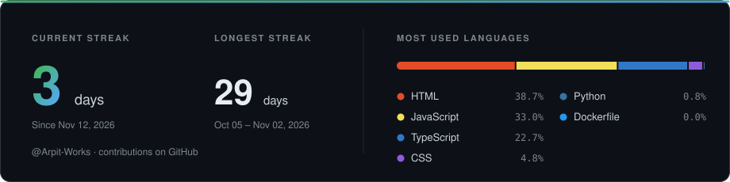

<!-- Banner -->
<p align="center">
  
</p>

<!-- Typing animation -->
<p align="center">
  <a href="https://arpit-omega.vercel.app/">
    
  </a>
</p>

<!-- Primary buttons -->
<p align="center">
  <a href="https://arpit-omega.vercel.app/"></a>
  <a href="https://drive.google.com/file/d/1Sz3t9RNbCna1JFTx0fq4SClsl7nLMgxX/view"></a>
  <a href="https://www.linkedin.com/in/arpit-vishwakarma23/"></a>
  <a href="mailto:vishwakarmaarpit621@gmail.com"></a>
</p>

<p align="center">
  
  
  
</p>

---

## 👨‍💻 About Me

- 💼 **Associate Software Engineer @ Netcore Cloud**
- 🔧 Backend-focused developer with experience building and debugging production systems
- 🚀 Experienced in **REST APIs, authentication, real-time systems, monitoring, and debugging**
- 🧩 Interested in **Microservices, Distributed Systems, System Design, and Backend Architecture**
- 🐳 Currently deepening my knowledge of **Docker, scalable systems, and cloud infrastructure**
- 📍 Mumbai, India

---

## 🧠 What I Work With

```text
Backend Development
        ↓
REST APIs & Authentication
        ↓
Databases & Caching
        ↓
Microservices & Distributed Systems
        ↓
System Design & Scalability
```

---
<h2 align="center">Tech Stack</h2> <p align="center">  </p> <p align="center"><sub>Observability: Kibana · Opsgenie · Jira &nbsp;|&nbsp; Cloud: AWS (EC2, SQS, Load Balancing), GCP</sub></p>


## 💼 Professional Experience

<table>
  <tr>
    <td width="130" align="center" valign="top">
      <br /><br />
      <sub><b>Mumbai, India</b></sub>
    </td>
    <td>
      <h3>Associate Software Engineer · <a href="https://netcorecloud.com">Netcore Cloud</a></h3>
      <sub><i>Production reliability · Observability · Backend support</i></sub>
      <br /><br />
      <table>
        <tr>
          <td align="center"><h3>100k → 40k</h3><sub>monthly alerts<br />after noise reduction</sub></td>
          <td align="center"><h3>Python + Bash</h3><sub>automated monitoring<br />&amp; ops workflows</sub></td>
          <td align="center"><h3>Microservices</h3><sub>monitored &amp; debugged<br />in production</sub></td>
        </tr>
      </table>
      <br />
      <b>🔍 Incident response</b> — Investigate production incidents using logs, traces, metrics and API debugging.<br />
      <b>⚙️ Automation</b> — Built Python &amp; Bash tooling to remove manual operational work.<br />
      <b>🚀 Performance</b> — Work with backend teams to find bottlenecks and improve system reliability.<br />
      <b>🛠️ Internal tooling</b> — Contribute to tools that improve team efficiency.
      <br /><br />
      
      
      
      
      
      
    </td>
  </tr>
</table>

---

## 🚀 Featured Projects

<table>
  <tr>
    <td width="50%" valign="top">
      <h3>🏫 MIS Dashboard</h3>
      <sub><i>Role-based college management system</i></sub>
      <p>Full-stack platform built around secure role-based access and real-time communication.</p>
      <ul>
        <li>🔐 JWT auth with refresh token rotation</li>
        <li>👥 Role-based access control</li>
        <li>⚡ Real-time updates via Socket.io</li>
        <li>📊 Analytics &amp; reporting dashboards</li>
        <li>🔌 REST API + MongoDB data layer</li>
      </ul>
      
      
      
      
      
      <br /><br />
      <!-- TODO: replace with the real repo link -->
      <a href="https://github.com/Arpit-Works?tab=repositories"></a>
    </td>
    <td width="50%" valign="top">
      <h3>🌐 Personal Portfolio</h3>
      <sub><i>Developer portfolio &amp; project showcase</i></sub>
      <p>Fast, accessible portfolio presenting my experience, projects and technical skills.</p>
      <ul>
        <li>⚡ Performance optimized</li>
        <li>🔎 SEO optimized</li>
        <li>🧩 Reusable component architecture</li>
        <li>📱 Fully responsive design</li>
        <li>🛡️ Type-safe with TypeScript</li>
      </ul>
      
      
      
      <br /><br />
      <a href="https://arpit-omega.vercel.app/"></a>
    </td>
  </tr>
</table>

---

## 📊 GitHub Stats

<p align="center">
  
</p>

---

## 🤝 Let's Connect

<p align="center">

<a href="https://github.com/Arpit-Works">
  
</a>

<a href="https://www.linkedin.com/in/arpit-vishwakarma23/">
  
</a>

<a href="mailto:vishwakarmaarpit621@gmail.com">
  
</a>

</p>

---

<p align="center">
  <i>Building reliable systems. Solving real problems. Learning every day.</i>
</p>
